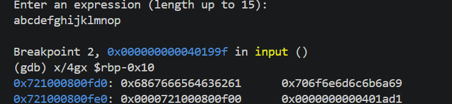
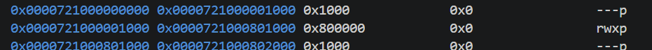
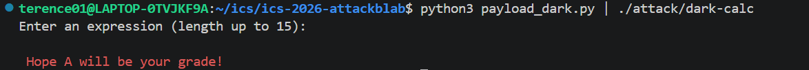

# Attack Lab 实验汇报

- 姓名：宋翼如
- 学号：25300120083
  
## 观察input栈帧
先观察源码
```
 if(!gets(expression) || strlen(expression) == 0) {
      puts(answer);
      exit(0);
  }
```
出现的gets函数是程序课上介绍的典型危险函数，他没有判断输入的字符串长度，而expression这个数组最多接受15个字符串。我们看input函数的编译码，前三行其实已经说明了栈帧的变化：
```
   0x0000000000401977 <+0>:     push   %rbp
   0x0000000000401978 <+1>:     mov    %rsp,%rbp
   0x000000000040197b <+4>:     sub    $0x10,%rsp
```
程序给expression留了16个字节，算上push的rbp寄存器，一共是24个字节。我们用gdb，先观察调用gets函数的栈帧情况，阅读汇编码，`0x0000000000401993 <+28>:    lea    -0x10(%rbp),%rax` 刚好是将expression地址最低的那一个字节存在rax里面，我们在这里设置断点，观察此时的动态栈帧情况：


图1

显然，如果我们以8个字节为一个单位显示，第一行显示的是expression的16个字节，这在第二种输出方式中更清楚看到，expression中全是0为空。第二行位置更高的是input一开始被压入的被调用者（caller）的rbp，和caller的返回地址。接着continue运行程序，我选择先输入一个15位以内不会产生错误的输入`abcdefghijklmno`,然后在gets函数调用后设置断点，并观察战阵：


图2

显然，expression对应的内存中保存了我刚才输入的15个英文字符的ASCII码，末尾为`/0`。第二种输出方式（ai教我的）能直接看到内存中的值。注意到这里其实是合法输入，假设我们输入了长度长于16的字符串，那就会影响栈地址更高的rbp和返回地址。这是我们在开始下一步实验之前自己的推断。

## 用不同长度的字符串输入测试
小于等于15字节的安全输入我们已经分析过了，输入前的栈帧情况是一样的，所以只保留puts调用后的断点，我们先来看边界情况为16的输入`abcdefghijklmnop`；


图3

前面16位明显是`abcdefghijklmnop`的ASCII码，但是观察到地址`0x721000800fe0`的最高两位从`0f` 被改写为`00`，这是因为数组需要在末尾加上`/0`,从而发生了缓冲区溢出，原来的rbp被覆盖，程序发生了错误。再来看24位的输入`abcdefghijklmnopqrstuvwx`：


图4

很明显，expression内16位被写满，原来栈内的rbp也被`qrstuvwx`的ASCII码覆盖，产生更多的溢出错误。

## 利用缓冲区漏洞执行 `./malware`
先分析`malware`这个命令行脚本，它的功能是检查父进程里是否有`dark-calc`，所以我们的任务是在执行`dark-calc`的时候也同时执行了`malware`，并判断炸弹被引爆。接着看`dark-calc.c`。他是一个简单的计算器，先调用之前分析过的有问题的`input`函数进行输入，然后再在输入前面套上`"echo $(("`，在输入后套上`"))"`，把输入转化为一个命令行指令交给`system()`来运行。

问题是，`system`函数有一整套shell语法，并不是只能简单的做运算，我们可以直接尝试输入`$(./attack/malware)`，这样就可以直接执行`malware`了！但是注意到这个输入大于16位，会被`eval`函数截断，所以我们缩短一下，使用linux的匹配查找命令`$(./attack/m*)`，最终成功，具体结果如下：


图5

显示成功引燃炸弹。从输出中也能明显看到，运行顺序为`dark-calc`，`sh`(用`system`命令调用的shell) ，``malware``

## 用 GDB 检查 main 函数的机器码

图6

这个就是简单的保存之前的`rbp`，然后循环：清零`eax`调用`input`函数，再清零`eax`调用`eval`函数。

## 栈空间执行
先找到`grade_eval`函数，就是判断输入的数是不是4，这也是我们攻击的目标。但是在`main`函数中，却没有调用`grade_eval`。所以为了调用该函数，我们需要利用前面分析过`gets`函数的漏洞。


图7

在gdb调试中可以看到，从`0x00007ffffffdd000`到`0x00007ffffffff000`这段内存空间是有权限直接执行的，与图1比对，这段内存包含了`input`函数的栈中的返回地址。也就是说，如果我输入的是32位的字符串，那么后8位会刚好覆盖返回地址，只需要让他指向`grade_eval`函数即可，同时还需要保证`rdi`的值是4。那么需要编写24byte的shellcode，我的答案如下：
```
    "48 8d 64 24 80 "               lea -0x80(%rsp),%rsp
    "6a 04 5f "                     push $4; pop %rdi
    "b8 87 1a 40 00 "               mov $0x401a87,%eax
    "ff d0 "                        call *%rax
    "6a 3c 58 "                     push $60; pop %rax
    "31 ff "                        xor %edi,%edi
    "0f 05 "                        syscall
    "90 90"                         nop; nop
```
最后把返回地址改为expression的起始地址，也就是shellcode的起始地址。以下为实验成功的截图：


图8

